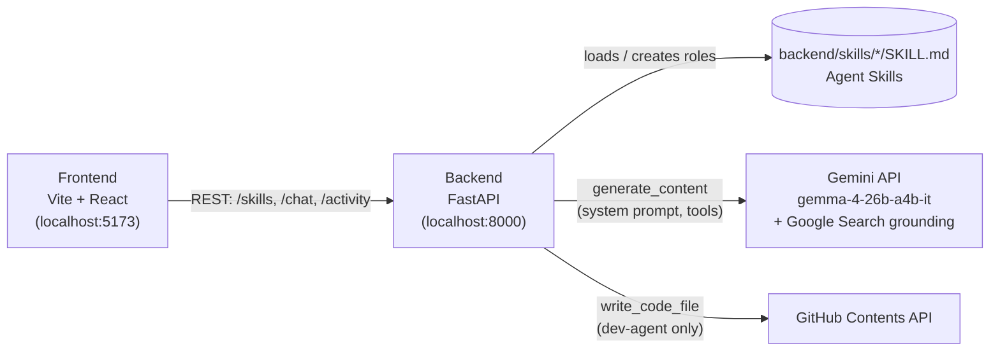

# Agent HQ

**Your AI team, in a chat app.** Agent HQ turns multi-agent orchestration into something
everyone already knows how to use: a messaging app. Each conversation in the sidebar is an
AI agent with its own role. Chat with your research agent and it searches the web; ask your
dev agent for a feature and it commits the file straight to your GitHub repo. Agents also
talk to *each other*: the dev agent can consult the research agent before writing code, and
you watch the handoff happen live in the Activity feed. Need a new specialist? Click
**+ New Agent**, give it a name and a job description, and it's on the team immediately. No
config files, no restarts, no orchestration code.

> Built for **Best Use of Gemma 4** and **Best Open-Source AI Project**.

## Architecture



- **Frontend** (`frontend/`): a two-pane chat UI with the agent list and an Activity tab on
  the left, and the conversation on the right. Each chat keeps its own history and draft.
  Tool use appears as a small status line above the reply, for example "searched the web",
  or "wrote … to GitHub · view on GitHub".
- **Backend** (`backend/`): FastAPI. For every message it loads the agent's role, calls
  **Gemma 4 (`gemma-4-26b-a4b-it`) through the Gemini API** with that role as the system
  instruction, and runs any tool calls the model makes until it replies.
- **Tools**:

  | Tool | What it does | Who gets it |
  |---|---|---|
  | Google Search grounding | Gemini's built-in web search | research-agent and every custom agent |
  | `ask_agent(agent_name, question)` | Runs another agent once and returns its answer | every agent |
  | `write_code_file(path, content, commit_message)` | Creates or updates a file through the GitHub Contents API | **dev-agent only** |

  Delegation is one level deep and **read-only**: an agent answering an `ask_agent` call
  can't write files or delegate further. Only a direct chat with dev-agent can commit to
  the repo.
- **Activity feed**: every tool call, from any chat, is logged in memory as
  `{agent, action, timestamp}`. `GET /activity` returns the latest 20, and the Activity tab
  refreshes every 3 seconds while it's open.

### API

| Method | Path | Description |
|---|---|---|
| `GET` | `/health` | Health check |
| `GET` | `/skills` | List agents: `[{name, description}]` |
| `POST` | `/skills` | Create an agent: `{name, description, role_prompt}` → `201`, or `400` (invalid name) / `409` (already exists) |
| `POST` | `/chat/{skill_name}` | `{message, history: [{role, text}]}` → `{reply, tool_used, url}` |
| `GET` | `/activity` | Latest 20 tool uses, newest first |

## The agents

### dev-agent
The team's software engineer. Describe a feature, fix or file, and it writes real, working
content and **commits it directly to your GitHub repo** (the repo set in `GITHUB_REPO`). The
reply links to the file on GitHub. If it needs background first, it asks research-agent.

### research-agent
The team's research analyst. It answers questions about current events, facts, comparisons
and background using **live Google Search grounding**, and it answers other agents' questions
too.

### Your own agents, created at runtime
Click **+ New Agent** in the sidebar. Give it a **name** (e.g. `sales-agent`) and describe
**what its job is**. The agent is live immediately and its chat opens straight away, with no
restart. Custom agents can search the web and consult other agents, but can't write to your
repo.

## Roles are Agent Skills

Every agent's role is an [Agent Skill](https://agentskills.io), the open standard for
packaging agent instructions. A skill is a folder containing a `SKILL.md` file with YAML
frontmatter (`name`, `description`) followed by markdown instructions:

```
backend/skills/
├── dev-agent/SKILL.md
├── research-agent/SKILL.md
└── sales-agent/SKILL.md      ← created from the UI with "+ New Agent"
```

```markdown
---
name: research-agent
description: Finds and summarizes current information from the web…
---

# Research Agent

You are the team's research analyst. …
```

The backend scans `backend/skills/*/SKILL.md` at startup. **+ New Agent** writes a real skill
folder to disk, not a database row, so agents you create are ordinary, portable skills: you
can commit them, edit them, or reuse them in any other tool that supports Agent Skills. Names
follow the spec: lowercase letters, numbers and single hyphens, at most 64 characters.

## Setup

**Requirements:** Node.js 20.19+ or 22.12+, Python 3.10+, a
[Gemini API key](https://aistudio.google.com/apikey), and a GitHub token that can write to
the target repo.

### 1. Backend

```bash
cd backend
python -m venv .venv
source .venv/bin/activate          # Windows Git Bash: source .venv/Scripts/activate
pip install -r requirements.txt
cp .env.example .env               # then fill in the values below
uvicorn main:app --reload
```

The API runs on http://localhost:8000 (check http://localhost:8000/health).

Required `backend/.env` values:

| Variable | Value |
|---|---|
| `GEMINI_API_KEY` | Your Gemini API key (used to call `gemma-4-26b-a4b-it`) |
| `GITHUB_TOKEN` | A GitHub token with **Contents: read & write** on the target repo (a fine-grained personal access token scoped to that one repo is recommended) |
| `GITHUB_REPO` | The repo dev-agent commits to, as `owner/repo` |

`.env` is git-ignored. Never commit it.

### 2. Frontend

```bash
cd frontend
npm install && npm run dev
```

Open http://localhost:5173. The frontend calls the backend at `http://localhost:8000` by
default. To change that, set `VITE_API_URL` in `frontend/.env`.

### Try it

1. **Research Agent**: "What happened in AI news this week?" → *searched the web*
2. **Dev Agent**: "Ask the research agent for the latest stable Python version, then write
   `agent-outputs/python-version.md` stating it." → *asked research-agent (searched the
   web), wrote … to GitHub*
3. **+ New Agent**: `sales-agent`, "Research companies and summarize who to reach out to and
   why." Then ask it about a company.
4. Open the **Activity** tab to watch every tool call across all agents.

> **Heads-up:** dev-agent commits straight to the default branch of `GITHUB_REPO`. Point it
> at a repo, or a fork, where that's OK.

## License

Released under the [MIT License](LICENSE). Copyright (c) 2026 missteaaaaaaa.
